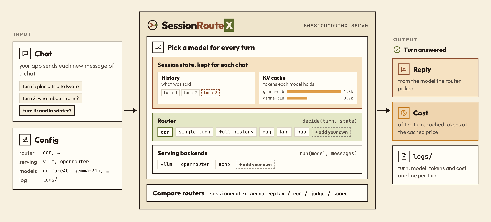

<p align="center">
  <picture>
    <source media="(prefers-color-scheme: dark)" srcset="docs/static/logo-dark.png">
    
  </picture>
</p>

<p align="center"><strong>A session layer for multi-turn LLM routing</strong></p>

<p align="center">
  <a href="https://claude.ai/artifact/AYHUoA4NUXJdo1Dd71U6G1">
    
  </a>
  <a href="https://openreview.net/forum?id=CPCK7uqzh3">
    
  </a>
</p>

---

A router picks which model answers each message of a chat: a cheap model for an easy follow-up, a strong one for a
hard question, without paying twice for the same chat history. SessionRouteX keeps two states for every chat, what
was said (the history) and how many tokens each model already holds for it (the KV cache), so any router can read
both. Your app talks to one gateway; the router picks a model for every turn; the serving backend's usage keeps both
states up to date and gives the bill.

<p align="center">
  <picture>
    <source media="(prefers-color-scheme: dark)" srcset="docs/static/overview-dark.png">
    
  </picture>
</p>

## Install

```bash
git clone https://github.com/UCF-ML-Research/SessionRouteX.git && cd SessionRouteX
pip install -e ".[serve]"            # the package, the `sessionroutex` command and the gateway
pip install -e ".[encoder]"          # live embeddings for the built-in routers (transformers, granite-4.2-3b)
```

Python 3.10+. Serving and the tests run on CPU; the encoder is faster on a GPU. The routers train on the
SessionRouteX data: set `SRX_DATA_DIR` to its folder (layout in [docs/REFERENCE.md](docs/REFERENCE.md#data)).

## Get started

One file says what to run:

```yaml
# config.yaml
# router: cor, single-turn, full-history, rag, knn, bao, or your own
router: cor
serving: [vllm, openrouter]
models:
  vllm: [gemma-e4b, gemma-26b-a4b]
  openrouter: [gemma-31b, mistral-medium-128b]
log: logs/
```

```bash
sessionroutex train --router cor --out runs/cor    # once: trains CoR on $SRX_DATA_DIR
sessionroutex serve configs/serve.yaml             # the gateway, on :8080
```

Your app sends each turn to the gateway; the router picks, SessionRouteX runs the pick:

```python
# app.py
import sessionroutex

s = sessionroutex.open("chat-1", gateway=":8080")
for msg in chat:
    reply = s.chat(msg)       # route, run, observe
    print(reply.turn, reply.model, reply.cost)
```

The gateway also speaks the OpenAI API (`POST /v1/chat/completions`, with a `chat_id` field or an `X-Chat-Id`
header), so an existing OpenAI client works unchanged. Each turn is three calls on the chat's session:

```python
s = sessionroutex.open(chat_id, config="config.yaml")   # a session without a gateway
d = s.route(messages)     # -> Decision(model, quality, cost)
o = s.run(d, messages)    # the chosen model answers
s.observe(o)              # -> both states updated
```

No GPU and no API keys: `sessionroutex serve examples/config.yaml` runs the same with the `echo` backend and the
router below, and `python examples/app.py` talks to it.

## Your router

A router is one file: history → quality, KV cache → cost, then pick.

```python
from sessionroutex import register_router, Router
from sessionroutex.parts import CacheCost
from my_lab import MyQuality      # your code

@register_router
class MyRouter(Router):
    name = "my-router"
    quality = MyQuality()      # reads the history
    cost = CacheCost()         # reads the KV cache

    def decide(self, turn, state):
        q = self.quality(turn, state.history)
        c = self.cost(turn, state.kv_cache)
        return self.pick(q, c)

# after the reply, SessionRouteX updates both states
```

Put it in `routers/my_router.py` next to the config and change one line, `router: my-router`. `pick` takes
the model with the highest `(1 - lam) * quality - lam * cost`; `lam` (default 0.5) weighs cost against quality.
The same `decide` runs in the arena's replay, so `sessionroutex arena replay --router routers/my_router.py --dev`
compares it with the built-in routers.

| Router | Quality from | Cost in the decision |
|---|---|---|
| `cor` (ours) | Dialogue State Predictor: local attention over past turns, a GRU state and a gate | cached prefix of each model at the cached price (`CacheCost`) |
| `single-turn` | MLP on the current query | full input price (`StaticCost`) |
| `full-history` | MLP on the history and the query | full input price |
| `rag` | MLP on the query and the 2 most similar past turns | full input price |
| `knn` | labels of the 20 most similar training queries | full input price |
| `bao` | MLP on the history and the query (Bao et al., simplified) | full input price and a penalty for switching models (`SwitchCost`) |

## Serving backends

| Backend | What it runs |
|---|---|
| `vllm` | a vLLM server (`vllm serve ... --enable-prompt-tokens-details`); key, if any, from `VLLM_API_KEY` |
| `openrouter` | OpenRouter; key from `OPENROUTER_API_KEY` |
| `echo` | repeats the last message, with a prefix cache: for tests and dry runs |

Both API backends read the cached tokens from `usage.prompt_tokens_details.cached_tokens`. A new backend is one
file too:

```python
from sessionroutex import register_serving, Serving

@register_serving
class MyBackend(Serving):
    name = "my-backend"
    models = ["gemma-26b-a4b", "gemma-31b"]

    def run(self, model, messages):
        reply = my_client.chat(model, messages)
        return reply.text, reply.usage    # usage: new and cached tokens

    def prices(self, model):
        return PRICES[model]              # $ per 1M tokens, cached and not
```

## Arena

SessionRouteX Arena compares routers on the same chats, in two tracks.

**Static.** Every turn of 3,996 real conversations was answered by the same 9 models and rated by a judge. A router
is trained on the train split and replayed on the test split: its pick at each turn gets that model's rating, and the
cost follows each model's KV cache along the routed path. The test ratings are hidden; the organizers replay
submitted routers.

```bash
sessionroutex arena replay --router routers/my_router.py --dev     # locally, on a held-out part of train
sessionroutex arena replay --router cor bao                        # organizers: needs SRX_HIDDEN_DIR
sessionroutex arena leaderboard runs/arena/static/results.json     # -> LEADERBOARD.md
```

**Dynamic.** Whole conversations played live: a simulated user (default DeepSeek-V4.1-Flash-1017) writes each user
turn, your router picks from your own pool, the model answers, and a judge (default NVIDIA Nemotron 3.5 Super) rates
every answer. You run it with your own endpoints and keys.

```bash
sessionroutex arena run    --config pool.yaml --tasks test.jsonl --out runs/dyn/mine --user-url URL
sessionroutex arena judge  --log runs/dyn/mine --judge-url URL
sessionroutex arena score  --log runs/dyn/mine
sessionroutex arena submit --log runs/dyn/mine
```

## Leaderboard

Static-track results of the six built-in routers are in **[LEADERBOARD.md](LEADERBOARD.md)**.

## Documentation

- [Website](https://claude.ai/artifact/AYHUoA4NUXJdo1Dd71U6G1): what it does, results, a live chat.
- [docs/REFERENCE.md](docs/REFERENCE.md): every command and option, the config, the data format, the cost
  accounting and the track rules.

## Citation

```bibtex
@inproceedings{xue2026chainofroute,
  title     = {Chain-of-Route: State-Aware {LLM} Routing for Multi-Turn Conversations},
  author    = {Xue, Jiaqi and Zheng, Mengxin and Huang, Heng and Lou, Qian},
  booktitle = {Advances in Neural Information Processing Systems (NeurIPS)},
  year      = {2026},
  url       = {https://openreview.net/forum?id=CPCK7uqzh3}
}
```
