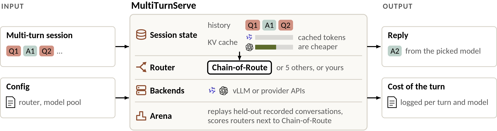
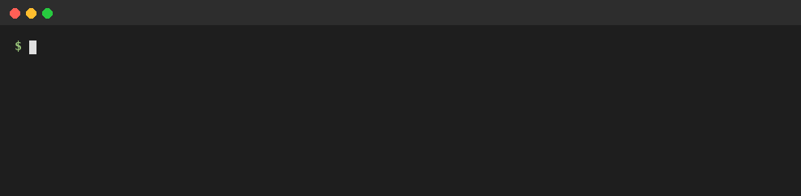

<h1 align="center"> MultiTurnRoute: A Platform for Building and Evaluating Multi-Turn LLM Routers</h1>

<p align="center">
  <b>Project</b>&nbsp; · &nbsp;
  <a href="https://loopleap-lab.github.io/MultiTurnRoute/">Website</a> ·
  <a href="https://openreview.net/forum?id=CPCK7uqzh3">Paper</a> ·
  <a href="#citation">Cite</a>
  <br>
  <b>Get started</b>&nbsp; · &nbsp;
  <a href="#quick-start">Quick start</a> ·
  <a href="#demo">Demo</a> ·
  <a href="LEADERBOARD.md">Leaderboard</a> ·
  <a href="https://github.com/loopleap-lab/MultiTurnRoute/issues">Issues</a>
  <br>
  <b>Reference</b>&nbsp; · &nbsp;
  <a href="#documentation">Docs</a> ·
  <a href="docs/routers.md">Routers</a> ·
  <a href="docs/backends.md">Backends</a> ·
  <a href="docs/FAQ.md">FAQ</a> ·
  <a href="ROADMAP.md">Roadmap</a>
</p>

## About

**MultiTurnRoute** is a platform for building and evaluating routers that choose an LLM at each turn of a conversation. A registered router reads the current query, dialogue history, and an estimate of each candidate model's reusable prefix length. It selects one model. The reply extends the dialogue, and the runtime updates the prefix estimate from the selected model's prompt and output token counts.

<p align="center"><a href="docs/assets/overview.pdf"></a></p>

**Chain-of-Route (CoR)** is our routing algorithm. The Dialogue State Propagator (DSP) learns how much recent and recurrent dialogue history to use when predicting quality. The Serving State Tracker (SST) estimates cost using each model's reusable prefix. CoR, five built-in baselines, and user-defined routers implement the same `decide(turn, state)` interface.

**Paper result (five-model benchmark).** On WildChat and LMSYS-Chat-1M, CoR reduced the normalized cost needed to match the strongest model’s quality by up to **20.3%** relative to the strongest routing baseline (Bao et al.), while matching or improving peak quality.

**MultiTurnRoute Arena** ranks routers by area under the deferral curve (AUDC) on recorded conversations. In the interactive track, a simulated user reads each reply and writes the next query. Routers are compared on matched tasks with the same model pool and user simulator. [Platform architecture](docs/architecture.md) · [Arena tracks](arena/README.md) · [Static leaderboard](LEADERBOARD.md)

## Demo

One multi-turn session, turn by turn: the model the router picked, the prompt tokens, how many of them that model
had cached, and the cost of the turn. The router moves to a larger model at turn 2, pays for the whole prompt once,
and then reuses that model's cache.



```bash
python -m demo.session        # no GPU and no API keys: the echo backend
```

[`demo/`](demo) explains the setup.

## Installation

```bash
git clone https://github.com/loopleap-lab/MultiTurnRoute.git
cd MultiTurnRoute
pip install -e ".[serve]"            # the package, the `multiturnserve` command and the gateway
pip install -e ".[encoder]"          # live embeddings for the built-in routers
```

The Python import and command-line executable are both named `multiturnserve`. MultiTurnRoute needs Python 3.10 or later. Its core dependencies are numpy, PyYAML and PyTorch (torch), so the
first install also installs torch. Serving and the tests run on CPU; the encoder is faster on a GPU. The
built-in routers train on the MultiTurnRoute data: set `MTS_DATA_DIR` to its folder. The data are not public yet
([ROADMAP](ROADMAP.md#6-data-and-checkpoints)); [toy data](docs/user-guide.md#toy-data) let you try training and
the arena without them. The [user guide](docs/user-guide.md) has the data layout and the other options.

## Quick start

These commands need no data, no GPU and no API keys. They use the example router and the `echo` backend of
[`examples/config.yaml`](examples/config.yaml), from the repository root:

```bash
python -m demo.session                        # one session in this process, turn by turn
multiturnserve serve examples/config.yaml     # the gateway, on :8080
python examples/app.py                        # in a second terminal: four turns through the gateway
```

To run `examples/app.py` again, restart the gateway or use a new session id; the client refuses an id the gateway
already has turns for.

`examples/app.py` sends each turn to the gateway. `turns` holds the user's messages, one per turn:

```python
import multiturnserve

turns = ["Summarize this paper", "Shorter, please", "Compare to RouteLLM", "Thanks!"]

s = multiturnserve.open("session-1", gateway=":8080")
for msg in turns:
    reply = s.chat(msg)       # route, run, observe
    print(reply.turn, reply.model, f"{reply.cost:.2e}")
```

It prints the turn, the model the router picked and the cost of the turn in USD:

```
1 gemma-e4b 2.40e-07
2 gemma-26b-a4b 1.61e-06
3 gemma-26b-a4b 1.92e-06
4 gemma-26b-a4b 1.60e-06
```

The gateway also speaks the OpenAI API: `POST /v1/chat/completions` with a `chat_id` field, an `X-Chat-Id`
header or the OpenAI `user` field naming the session, so an existing OpenAI client works unchanged. The API keeps
these OpenAI-style names (`chat_id`, `X-Chat-Id`, `user`, `/v1/chat/completions`) for compatibility; each one
names a session.

Without a gateway, a session runs in-process and each turn is three calls. `messages` is the session so far as an
OpenAI-style list of `{"role", "content"}` dicts, ending with the user's new message:

```python
s = multiturnserve.open("session-1", config="examples/config.yaml")
messages = [{"role": "user", "content": "Summarize this paper"}]
d = s.route(messages)     # -> Decision(model, quality, cost, t): the pick, its predicted quality, and its
                          #    estimated USD cost with a predicted output length
o = s.run(d, messages)    # the picked model answers
s.observe(o)              # both states updated
```

Use either `chat()` or the three calls in one session, not both. `chat()` keeps its own message list, and turns
made with `route`, `run` and `observe` are not in it.

### Chain-of-Route on the MultiTurnRoute data

The built-in routers, Chain-of-Route among them, are trained on the MultiTurnRoute data before they serve. The
data are not public yet ([ROADMAP](ROADMAP.md#6-data-and-checkpoints)). With the data in `$MTS_DATA_DIR`:

```yaml
# config.yaml
router: cor                # or single-turn, full-history, rag, knn, bao, or your own
serving: [vllm, openrouter]
models:
  vllm: [gemma-e4b, gemma-26b-a4b]
  openrouter: [gemma-31b, mistral-medium-128b]
log: logs/
```

```bash
multiturnserve train --router cor --out runs/cor    # once: trains CoR on $MTS_DATA_DIR
multiturnserve serve config.yaml                    # the gateway, on :8080
```

The [user guide](docs/user-guide.md) covers the rest: the command line, the config, training, logs and the arena.

## Routers

| Router | Quality from | Cost in the decision |
|---|---|---|
| `cor` (ours) | Dialogue State Propagator (DSP): local attention over past turns, a GRU state and a gate | estimated reusable prefix of each model at the cached price |
| `single-turn` | MLP on the current query | full input price |
| `full-history` | MLP on the history and the query | full input price |
| `rag` | MLP on the query and the 2 most similar past turns | full input price |
| `knn` | labels of the 20 most similar training queries | full input price |
| `bao` | MLP on the history and the query (Bao et al., simplified) | full input price and a penalty for switching models |

In the WildChat eviction study (Appendix H), SST observed each candidate’s surviving prefix length before model selection. In provider-API runs, the backend reports realized cache hits after the call when available.

## Serving backends

| Backend | What it runs |
|---|---|
| `vllm` | a vLLM server (`vllm serve ... --enable-prompt-tokens-details`); key, if any, from `VLLM_API_KEY` |
| `openrouter` | OpenRouter; key from `OPENROUTER_API_KEY` |
| `echo` | repeats the last message, with a prefix cache: for tests and dry runs |

## Adding your own router or backend

A router is a class with a `decide(turn, state)` method that returns the model for the turn. This one,
[`examples/my_router.py`](examples/my_router.py), reads the dialogue history for quality and the tracked prefix lengths for cost, then
picks:

```python
from multiturnserve import register_router, Router
from multiturnserve.parts import CacheCost
from my_lab import MyQuality      # your code; examples/my_lab.py stands in for it

@register_router
class MyRouter(Router):
    name = "my-router"
    quality = MyQuality()      # reads the history
    cost = CacheCost()         # reads the KV cache

    def decide(self, turn, state):
        q = self.quality(turn, state.history)
        c = self.cost(turn, state.kv_cache)
        return self.pick(q, c)
```

To serve it, put the file in a `routers/` folder next to the config, or list it under `plugins:` in the config,
and set `router: my-router`. [`examples/config.yaml`](examples/config.yaml) does this with `plugins:`. The same
`decide` runs in the gateway and in the arena. A serving backend is a class too: `run(model, messages)` returns
the text and the usage, and `prices(model)` the cached and uncached prices. [Routers](docs/routers.md) and [Backends](docs/backends.md) walk through both
with runnable code from [`examples/`](examples).

## Arena

MultiTurnRoute Arena compares routers on the same sessions, in two tracks.

- **Static track.** Every turn of 3,996 conversations from WildChat and LMSYS-Chat-1M (18,637 turns: 14,966 train,
  3,671 test) was answered by the same 9 models and rated by a judge. A router trains on the train split and is
  replayed on the held-out test split; the test ratings are hidden.
- **Dynamic track.** A simulated user responds to each model reply, and a judge rates each answer in context. For each cost weight, the Arena averages quality and normalized cost over rated turns and sums the billed cost over all turns.

```bash
multiturnserve arena replay --router examples/my_router.py --dev     # static track, on a held-out part of train
multiturnserve arena run --config pool.yaml --tasks my_tasks.jsonl --out runs/dyn/mine --user-url URL
```

The dynamic track plays tasks from a file you provide, in the `chat.jsonl` format; the test conversations are not
public yet.

The static track needs the MultiTurnRoute data in `$MTS_DATA_DIR`; [toy data](docs/user-guide.md#toy-data) run the
same commands. [`arena/`](arena) has the track rules.

**Arena result.** On the static track (3,671 test turns, 9 models, one run with seed 0), CoR reaches the quality of the
best single model, gemma-31b (0.7061), at 74% of gemma-31b's cost, interpolated on the upper envelope of its
cost-quality curve; none of the five baselines reaches that quality. [LEADERBOARD.md](LEADERBOARD.md) has every
router, and [Reproducing the leaderboard](docs/user-guide.md#reproducing-the-leaderboard) gives the
commands.

## Documentation

| document | what it covers |
|---|---|
| [User guide](docs/user-guide.md) | installing; the config; serving through the gateway, the OpenAI API and the Python session; training the built-in routers; logs; running the arena |
| [How MultiTurnRoute works](docs/architecture.md) | the session state, router, backend and arena layers and their interfaces; the route, run, observe loop; cost accounting with cached tokens; repository layout |
| [Routers](docs/routers.md) | the built-in routers; writing your own, with runnable code |
| [Backends](docs/backends.md) | the serving backends and their keys; how cached tokens are read; adding a backend |
| [Arena](arena/README.md) · [Leaderboard](LEADERBOARD.md) | the static and dynamic tracks, their rules, and the static-track results |
| [FAQ](docs/FAQ.md) | common questions and troubleshooting |
| [Demo](demo/README.md) | one multi-turn session on the echo backend |
| [Roadmap](ROADMAP.md) · [Changelog](CHANGELOG.md) | what is done and planned; what changed in each release |

## Status and roadmap

Serving, the six routers, the static track and the dynamic track run today. [ROADMAP.md](ROADMAP.md) lists what
comes next and the current limits, among them:

- trained checkpoints and the arena data are not yet published, so a built-in router is trained with
  `multiturnserve train` before it serves;
- dynamic-track results are self-reported;
- the live encoder's model id is not yet checked against the script that made the precomputed embeddings
  ([ROADMAP §2](ROADMAP.md#2-online-serving)), so a router served online may see slightly different inputs than
  in training;
- the package is installed from this repository, not from PyPI.

The numbers in [LEADERBOARD.md](LEADERBOARD.md) come from the run of the original evaluation package that
`arena replay` ports. The paper describes the static track (Section 5) but has no table or figure with these
numbers: its main results (Section 4) use a different, five-model pool.

## Issues and contact

Questions, bug reports and feature requests go to
[GitHub issues](https://github.com/loopleap-lab/MultiTurnRoute/issues).

## License

Apache License 2.0. See [LICENSE](LICENSE).

## Citation

If you use MultiTurnRoute or Chain-of-Route in your research, please cite the
[paper](https://openreview.net/forum?id=CPCK7uqzh3). You can also
[download the BibTeX entry](docs/assets/multiturnroute.bib).

```bibtex
@inproceedings{xue2026chainofroute,
  title     = {{MultiTurnRoute}: A Platform for Building and Evaluating Multi-Turn {LLM} Routers},
  author    = {Xue, Jiaqi and Zheng, Mengxin and Huang, Heng and Lou, Qian},
  booktitle = {Advances in Neural Information Processing Systems (NeurIPS)},
  year      = {2026},
  url       = {https://openreview.net/forum?id=CPCK7uqzh3}
}
```
