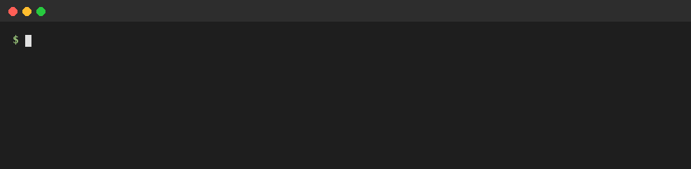

# Demo

One multi-turn session through MultiTurnServe, turn by turn. It needs no GPU and no API keys.

```bash
python -m demo.session        # from the repository root
```

The session runs the router and backends of [`examples/config.yaml`](../examples/config.yaml): the example
router ([`examples/my_router.py`](../examples/my_router.py)) on the `echo` backend and a stand-in backend. The
echo backend answers with the last message and caches the session's prefix like a serving engine, so the token
counts and costs are real accounting on toy answers.

Each line is one turn: the model the router picked, the prompt tokens, how many of them the model already had
cached, and the cost of the turn. In the recording the router moves to a larger model at turn 2. That model has
nothing of the session cached yet, so turn 2 pays for the whole prompt; from turn 3 on, most of the prompt is
cached and charged at the cached price.


